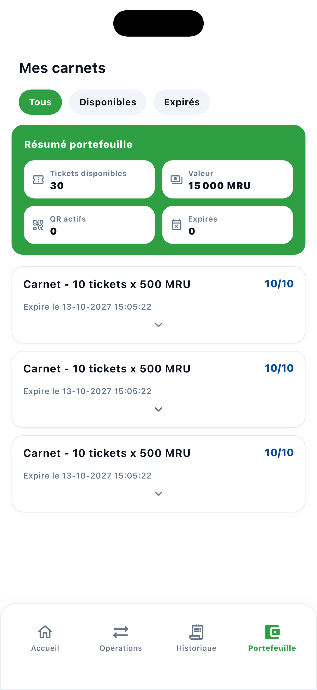
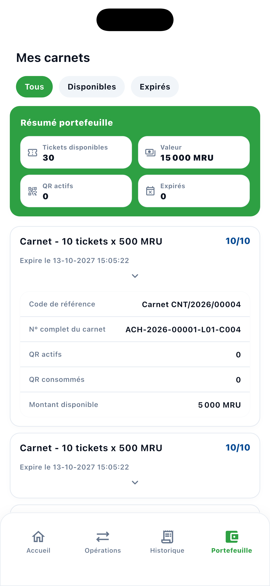
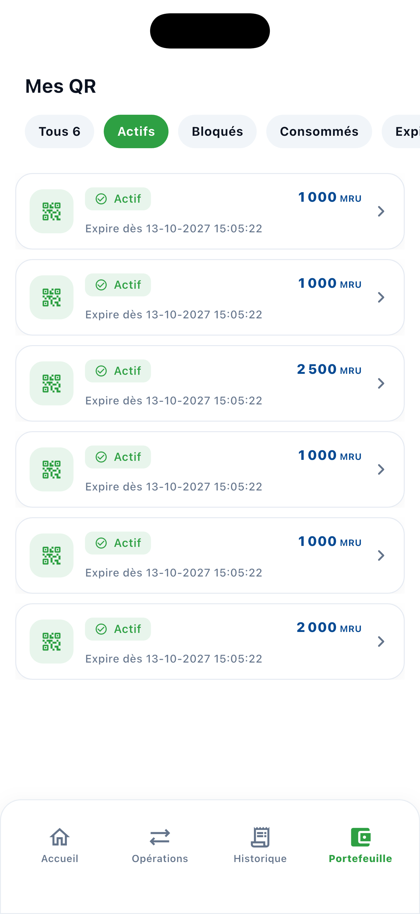
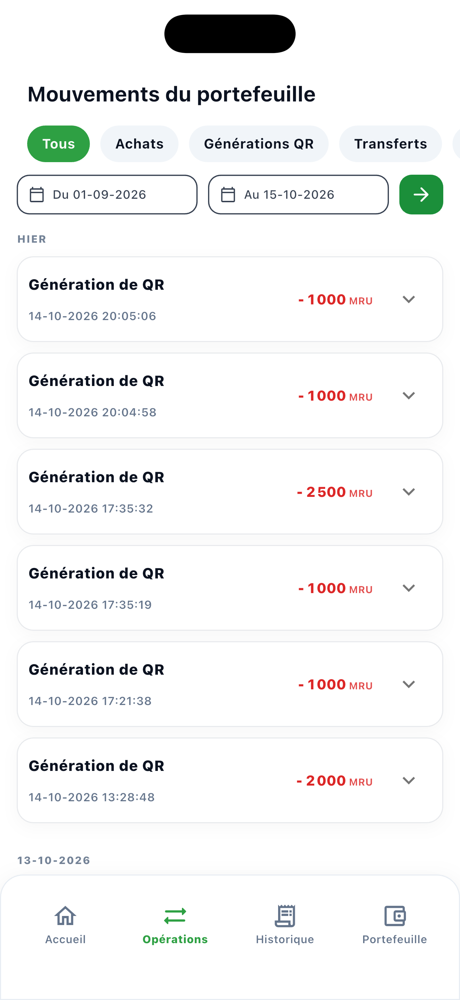
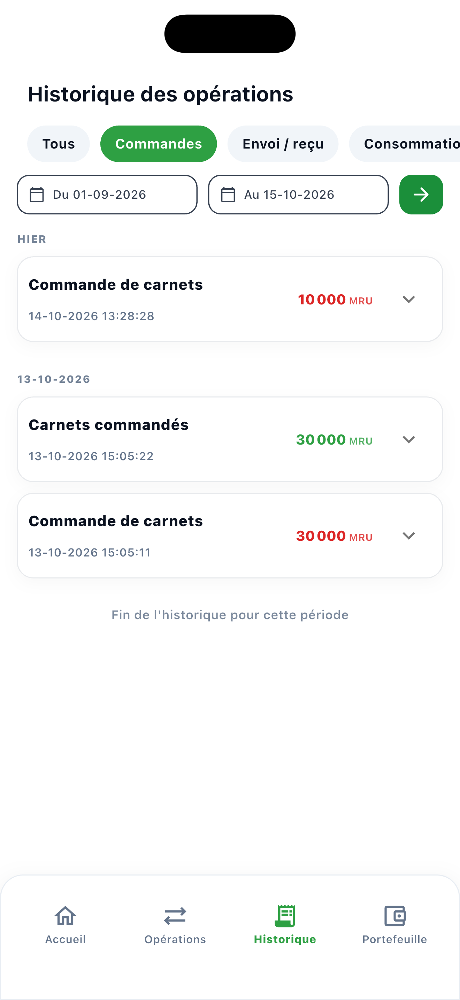
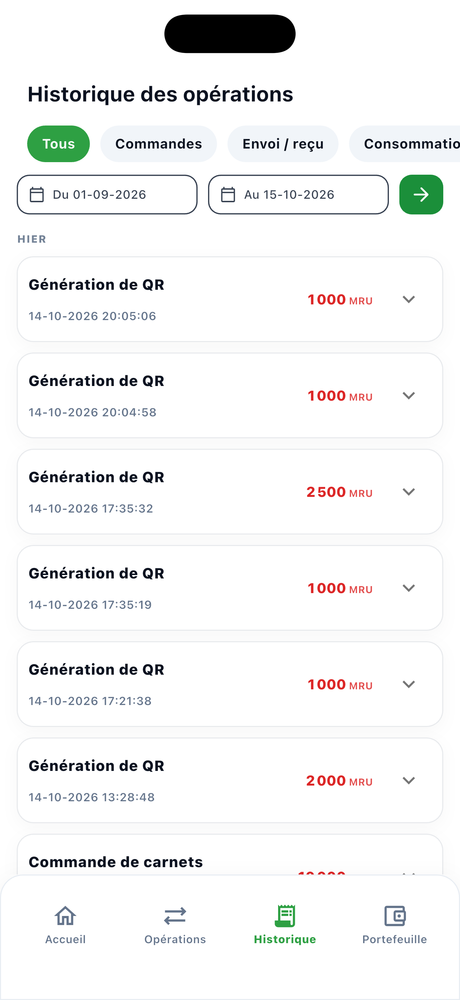
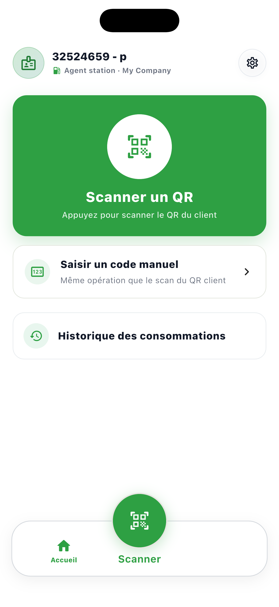
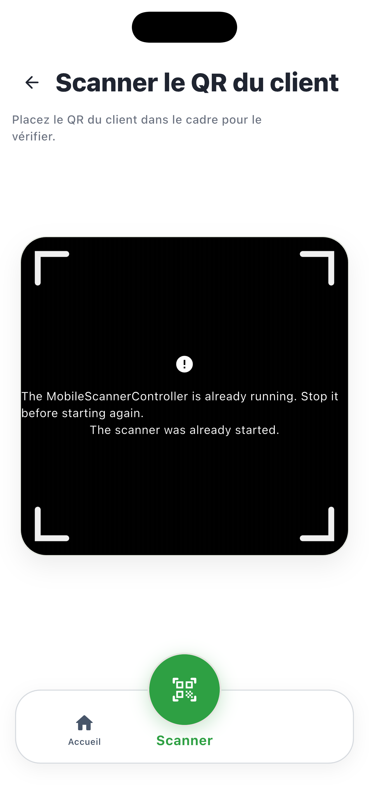
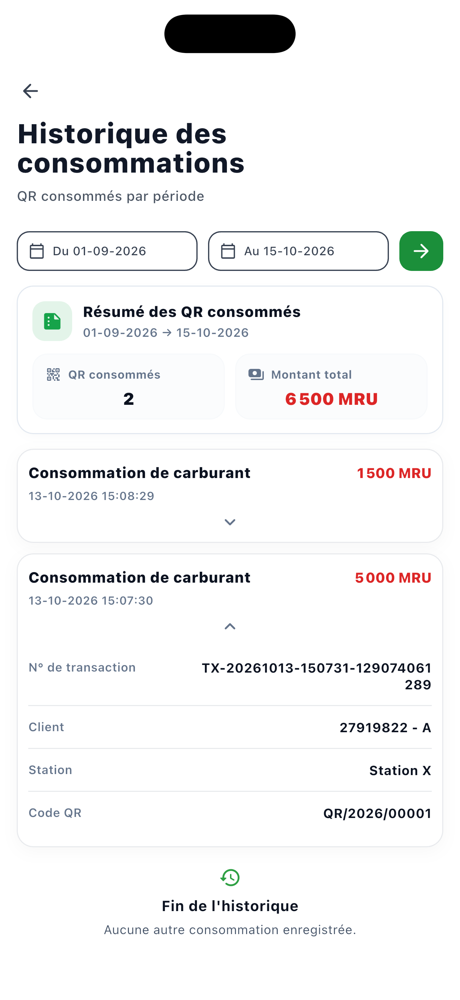

<p align="center">
  
</p>

# LP E-Tickets

## 1. Problème métier

La gestion papier des carnets de carburant rend les achats, transferts et consommations difficiles à suivre. Elle augmente les risques de perte, de fraude, de double utilisation et de manque de visibilité entre clients et stations.

## 2. Solution

LP E-Tickets digitalise ce parcours avec un portefeuille mobile, des QR codes vérifiables et un back-office Odoo. Chaque opération suit un cycle contrôlé et reste disponible dans un historique auditable.

LP E-Tickets est une solution mobile de gestion de carnets et tickets de carburant pour Leader Petroleum. Elle met en relation les clients, les stations et le système de gestion Odoo.

## Ce que permet la solution

- authentification sécurisée par numéro de téléphone et OTP ;
- demande et achat de carnets ;
- consultation du solde, des tickets et de l’historique des opérations ;
- ajout, affichage et téléchargement des preuves de paiement ;
- génération et partage de QR codes signés ;
- scan en station, validation de consommation et prévention des doublons ;
- transfert de carnets ou de tickets entre utilisateurs autorisés ;
- consultation de la carte et des informations des stations.

## 5. Captures d’écran iOS

Captures prises sur **iPhone 17 Pro Max**. Les opérations et historiques client couvrent la période du **1er septembre au 15 octobre 2026**. Cliquez sur une image pour l’agrandir. Le simulateur ne dispose pas de caméra : l’écran de scan affiche cette limitation.

<table align="center">
  <tr>
    <td align="center" valign="top" width="50%">
      <strong>Mes carnets</strong><br><br>
      <a href="docs/screenshots/iphone-17-pro-max/mes-carnets.png"></a>
    </td>
    <td align="center" valign="top" width="50%">
      <strong>Détail d’un carnet</strong><br><br>
      <a href="docs/screenshots/iphone-17-pro-max/detail-carnet.png"></a>
    </td>
  </tr>
  <tr>
    <td align="center" valign="top" width="50%">
      <strong>Mes QR</strong><br><br>
      <a href="docs/screenshots/iphone-17-pro-max/mes-qr.png"></a>
    </td>
    <td align="center" valign="top" width="50%">
      <strong>Opérations depuis le 1er septembre</strong><br><br>
      <a href="docs/screenshots/iphone-17-pro-max/operations.png"></a>
    </td>
  </tr>
  <tr>
    <td align="center" valign="top" width="50%">
      <strong>Historique des commandes</strong><br><br>
      <a href="docs/screenshots/iphone-17-pro-max/historique-commandes.png"></a>
    </td>
    <td align="center" valign="top" width="50%">
      <strong>Historique des opérations</strong><br><br>
      <a href="docs/screenshots/iphone-17-pro-max/historique-operations.png"></a>
    </td>
  </tr>
  <tr>
    <td align="center" valign="top" width="50%">
      <strong>Accueil station</strong><br><br>
      <a href="docs/screenshots/iphone-17-pro-max/station-accueil.png"></a>
    </td>
    <td align="center" valign="top" width="50%">
      <strong>Scan station</strong><br><br>
      <a href="docs/screenshots/iphone-17-pro-max/station-scan.png"></a>
    </td>
  </tr>
  <tr>
    <td align="center" valign="top" colspan="2">
      <strong>Historique des consommations</strong><br><br>
      <a href="docs/screenshots/iphone-17-pro-max/station-consommations.png"></a>
    </td>
  </tr>
</table>

L’administration métier (validation des achats, gestion des comptes, carnets, stations et rapports) est réalisée dans Odoo. L’application mobile ne contient pas d’espace d’administration autonome.

## Organisation du dépôt

| Dossier | Rôle |
| --- | --- |
| `LP-E-Tickets-Frontend` | Application Flutter mobile et web |
| `LP-E-Tickets-Backend` | Modules et services Odoo du projet |

## Présentation portfolio

LP E-Tickets est une plateforme mobile et ERP qui remplace les carnets papier par des e-tickets sécurisés. Elle centralise les achats, paiements, carnets, tickets et consommations tout en donnant à chaque acteur une vue adaptée à son rôle.

### Fonctionnalités clés

- authentification téléphone/OTP et gestion de session ;
- achat et validation de carnets ;
- portefeuille numérique et historique complet ;
- preuves de paiement avec prévisualisation et téléchargement ;
- QR codes signés, expiration et contrôle côté serveur ;
- scan en station et prévention des doubles consommations ;
- transferts de carnets/tickets avec traçabilité ;
- notifications et carte des stations ;
- interface client/station en français et en arabe.

### Architecture technique

```text
Flutter (Android / iOS / Web)
              │ REST / JSON-RPC sécurisé
              ▼
Odoo (modules métier, API, droits et validations)
              │
              ▼
PostgreSQL (données et historique)
```

Odoo est la source de vérité. L’administration des comptes, stations, carnets, paiements et rapports est réalisée dans Odoo ; le frontend ne contient pas d’espace d’administration autonome.

### Workflow métier

```text
Achat → Preuve de paiement → Validation Odoo → Portefeuille
      → QR code → Scan station → Consommation → Historique
```

### Stack

| Domaine | Technologies |
| --- | --- |
| Mobile | Flutter, Dart, BLoC, GoRouter |
| Backend | Odoo, Python, modules personnalisés |
| API | REST, JSON-RPC |
| Données | PostgreSQL |
| Cartographie | Flutter Map, LatLng |
| QR | Génération et scan mobile |
| Déploiement | Docker, Android, iOS, Web |

### Rôle et contributions

**Développement Full-Stack Flutter & Odoo** : conception des workflows métier, développement de l’application mobile, intégration des APIs Odoo, modélisation des carnets et QR codes, implémentation des achats/transferts/consommations, intégration cartographique et tests frontend/backend.

### Défis techniques

- garantir l’idempotence des opérations sensibles ;
- empêcher les doubles consommations d’un même QR code ;
- conserver la cohérence du portefeuille lors des transferts ;
- synchroniser les validations Odoo avec l’interface mobile ;
- protéger les preuves de paiement et les données personnelles.

### Confidentialité

Les credentials, tokens, clés d’API, fichiers `.env`, données clients et informations de paiement réelles ne doivent jamais être ajoutés au dépôt. La configuration de production doit rester dans un gestionnaire de secrets.

## Architecture en bref

L’application Flutter communique avec Odoo au moyen d’API sécurisées. Odoo reste la source de vérité pour les utilisateurs, achats, paiements, carnets, tickets, stations et consommations. Les QR codes sont vérifiés côté serveur avant toute consommation et les opérations sensibles utilisent des contrôles d’idempotence et de concurrence.

## Démarrer le frontend

Prérequis : Flutter/Dart installés et une instance Odoo configurée.

```bash
cd LP-E-Tickets-Frontend
flutter pub get
flutter run
```

Sous Windows, les scripts `run.ps1` et `run.cmd` peuvent être utilisés pour lancer l’application.

## Vérifier le code

```bash
cd LP-E-Tickets-Frontend
flutter analyze
flutter test
```

Les paramètres de connexion à Odoo doivent être fournis par la configuration d’environnement ou les fichiers de configuration prévus par le projet. Les mots de passe, jetons et fichiers `.env` ne doivent jamais être commités ; le fichier `.gitignore` les exclut du dépôt.

## Sécurité et responsabilités

- ne pas partager de secrets dans le code ou les tickets GitHub ;
- utiliser HTTPS entre l’application et Odoo ;
- vérifier les droits côté serveur, même si l’interface masque une action ;
- conserver les journaux et preuves nécessaires à l’audit ;
- tester les achats, validations, scans, transferts et rejouements avant une mise en production.

## État du projet

Le dépôt contient le frontend Flutter et les modules backend Odoo. Avant une mise en production, l’instance Odoo, les variables d’environnement, les certificats HTTPS, les sauvegardes et les tests d’intégration doivent être validés dans l’environnement cible.
